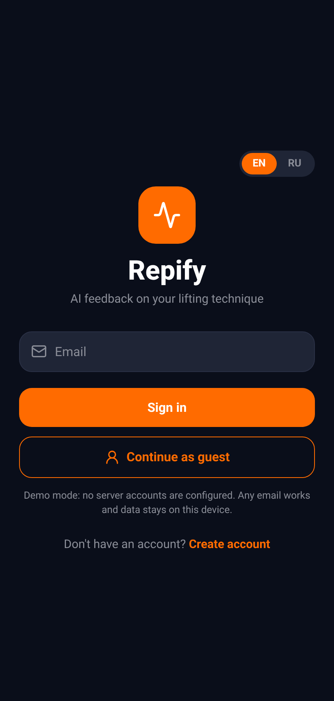
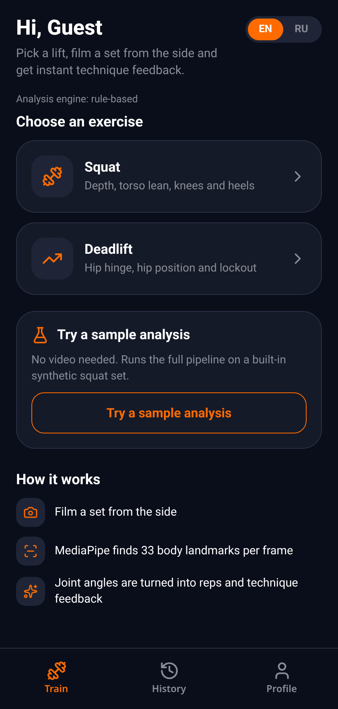
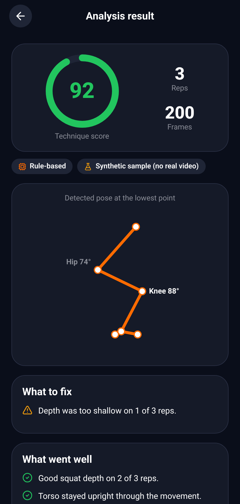
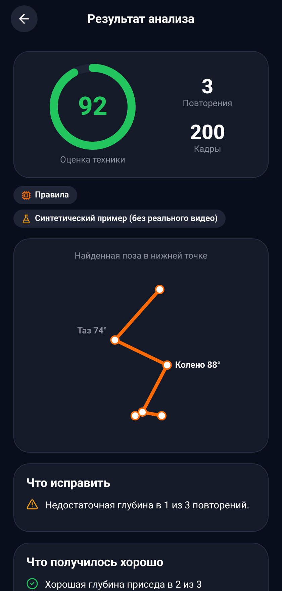
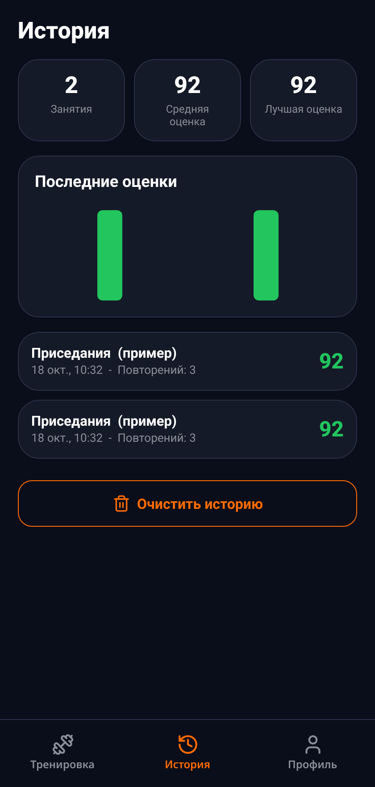

# Repify

AI feedback on the technique of 14 exercises from a single side-view video.

Film a set, and Repify finds your body landmarks, converts them into joint angles, counts the repetitions (or times the hold) and tells you what to fix: depth, lockout, torso lean, knee travel, body line, swing. It covers squat, deadlift, bench press, overhead press, push-up, pull-up, barbell row, lunge, Romanian deadlift, bicep curl, plank, hip thrust, dip and lat pulldown. The app runs on iOS, Android and the web (Expo / React Native), and speaks English and Russian.

| Sign in | Train | Result | Result (RU) | History (RU) |
|---|---|---|---|---|
|  |  |  |  |  |

The result screen draws the detected pose at the key point of the movement. The screenshots above come from the built-in synthetic sample (see [Demo without a video](#demo-without-a-video-and-demo-mode-without-a-backend)).

## How it works

```
 Expo app (iOS / Android / web)                FastAPI backend
 ------------------------------                -----------------------------------------------
 pick or record a video      --- video ---->   /api/extract-poses
                                                 OpenCV frame sampling -> MediaPipe Pose
                                               <-- 33 landmarks per frame --
 pose sequence               --- JSON ----->   /api/analyze
                                                 landmarks -> side selection -> knee/hip/torso angles
                                                 Gemini (if GEMINI_API_KEY is set)
                                                   -> otherwise / on failure: local rule-based analyzer
 score, reps, issues, tips   <-- JSON ------   reps, score, errors, strengths, coach tip, pose preview
 history stored on the device
```

- **Pose estimation:** MediaPipe Pose (33 landmarks) on the server, frames downscaled to 640x480.
- **Biomechanics:** angles at the knee (hip-knee-ankle), hip (shoulder-hip-knee) and elbow (shoulder-elbow-wrist), the body line (shoulder-hip-ankle), torso inclination, knee position relative to the toes, heel height, and a few landmark positions (wrist over elbow, nose above the bar, hip sway).
- **Rep counting:** a small state machine over the smoothed angle signal of each exercise: rest position, an excursion past a threshold, return to rest. Exercises that start low (overhead press, hip thrust) use the mirrored signal. The plank is timed from frame timestamps instead.
- **One registry:** every exercise is declared in `backend/app/services/exercises.py` (signal, thresholds, camera, checks); feedback strings in EN and RU live in `exercise_messages.py`.
- **Two analysis engines behind one response schema:**
  - *Local analyzer* (`backend/app/services/local_analyzer.py`): deterministic rules, no network, unit tested. It is the default.
  - *Gemini* (`gemini_analyzer.py`): receives compact joint data (not video) and returns a JSON verdict in the user's language. If the call fails, the API falls back to the local analyzer.
- **Personalisation:** the thigh to shin ratio is measured from the standing frames, so long-femur lifters are not penalised for extra forward lean.
- **Accounts:** Supabase Auth when configured, otherwise a local demo account (no server). Workout history is kept on the device.

## Supported exercises

Filming rule for all of them: **side view**, camera still, whole body in frame, 2-3 m away, start and finish every rep in the start position. Angles are in degrees; the pose is read in 2D, so a side view is what makes the joint angles trustworthy.

| Exercise (`id`) | Camera view | Rep signal | A rep counts when | Depth / ROM target | What is checked |
|---|---|---|---|---|---|
| Squat (`squat`) | Side, hip height | Knee angle (hip-knee-ankle) | from 160 or more, below 130, back above 160 | Knee 105 or less | Depth, torso lean over 60, knees far past the toes, heels lifting |
| Deadlift (`deadlift`) | Side, hip height | Hip angle (shoulder-hip-knee) | 160 or more, below 125, back | Lockout at 165 or more | Lockout, hips starting too low (knee under 85) |
| Bench press (`bench_press`) | Side of the bench, bar height | Elbow angle | 150 or more, below 110, back | Elbow 95 or less | Range, lockout 160 or more, forearm vertical at the bottom |
| Overhead press (`overhead_press`) | Side, chest height | Elbow angle (mirrored: low to high) | 115 or less, above 145, back | Lockout 165 or more | Lockout, leaning back over 15, bar over the shoulders |
| Push-up (`push_up`) | Side, floor level | Elbow angle | 150 or more, below 115, back | Elbow 100 or less | Depth, lockout, hips sagging, hips piked (body line under 160) |
| Pull-up (`pull_up`) | Side (a front view counts reps only) | Elbow angle | 150 or more, below 110, back | Elbow 90 or less, chin over the bar | Range, chin (nose above the wrist), full dead hang, body swing |
| Barbell row (`row`) | Side, hip height | Elbow angle | 150 or more, below 115, back | Elbow 100 or less | Range, torso too upright (under 30), torso heave (over 15 change) |
| Lunge (`lunge`) | Side, hip height | Knee angle of the near leg | 160 or more, below 125, back | Knee 105 or less | Depth, torso lean over 30, knee far past the toes |
| Romanian deadlift (`romanian_deadlift`) | Side, hip height | Hip angle | 160 or more, below 135, back | Hip 115 or less | Hinge depth, knees bending (under 130), lockout, bar drifting from the legs |
| Bicep curl (`bicep_curl`) | Side, chest height | Elbow angle | 150 or more, below 90, back | Elbow 65 or less | Top range, full extension 160 or more, elbows drifting forward, torso swing |
| Plank (`plank`) | Side, floor level | Body line (shoulder-hip-ankle) and time | Torso within 35 of horizontal | Hold 10 s or more, line 160 or more | Hips sagging, hips piked, shoulders over elbows, hold time; also a score per 5 s |
| Hip thrust (`hip_thrust`) | Side, hip height | Hip angle (mirrored: low to high) | 145 or less, above 160, back | Hip 170 or more | Full hip extension, vertical shins (knee 75-110) at the top |
| Dip (`dip`) | Side, chest height | Elbow angle | 150 or more, below 115, back | Elbow 100 or less | Depth, lockout, forward lean over 50 |
| Lat pulldown (`lat_pulldown`) | Side, shoulder height | Elbow angle | 150 or more, below 110, back | Elbow 100 or less | Range, full stretch at the top, lean over 35, torso rocking over 15 |

**All thresholds are heuristics.** They come from common coaching cues and were checked on synthetic landmark sequences (`backend/tests/test_exercises.py`), not on coach-labelled video, and they are defined in one place (`backend/app/services/exercises.py`) so they are easy to tune. Single-camera 2D analysis cannot judge elbow flare, knee valgus, spinal rounding or grip; those are not claimed. `GET /api/exercises` returns the same table as JSON.

## Tech stack

| Layer | Tools |
|---|---|
| App | Expo SDK 54, React Native 0.81, React Navigation 7, react-native-svg, lucide icons, expo-image-picker |
| i18n | Small context-based dictionary (`frontend/src/i18n`), EN and RU, language persisted on the device |
| Backend | Python 3.11, FastAPI, Pydantic v2, MediaPipe 0.10.14, OpenCV, google-genai |
| Auth | Supabase Auth (optional) |
| Tests | pytest (geometry, rep segmentation, scoring for all 14 exercises on synthetic landmark sequences, API, Gemini fallback) |

## Run it locally

### 1. Backend

Python 3.11 is required, because MediaPipe 0.10.14 has no wheels for newer interpreters.

```bash
cd backend
python3.11 -m venv .venv && source .venv/bin/activate
pip install -r requirements-dev.txt
cp .env.example .env            # optional: add GEMINI_API_KEY
uvicorn app.main:app --reload --port 8000
pytest                          # run the tests
```

Open http://localhost:8000/docs for the API. `GET /health` reports which engine is active.

Or with Docker: `docker build -t repify-api backend && docker run -p 8000:8000 repify-api`.

### 2. App

```bash
cd frontend
cp .env.example .env            # set EXPO_PUBLIC_API_URL (use your LAN IP on a phone)
npm install
npx expo start                  # press w for web, or scan the QR code with Expo Go
```

Production web build: `npm run build:web` (output in `frontend/dist`).

## Demo without a video, and demo mode without a backend

Every exercise page has **Run a sample analysis** (the Train tab also has one for squat). The backend generates a synthetic side-view set for that exercise (three reps with one deliberately weak rep, or a 14 second plank that sags at the end) and runs it through the same angle, rep-counting and scoring code as a real upload. The result is labelled as synthetic in the UI.

The sample results for all 14 exercises in English and Russian are also bundled with the app (`frontend/src/data/samples.json`, written by `backend/scripts/export_samples.py`, kept in sync by a test). When `EXPO_PUBLIC_API_URL` is empty the app runs in **demo mode**: samples come from the bundle, no server is needed, and uploading a video is hidden. This is how the Vercel preview works until a backend is attached.

## Configuration

| Variable | Where | Purpose |
|---|---|---|
| `GEMINI_API_KEY` | backend | Optional. Enables Gemini analysis. Without it the local analyzer is used. |
| `GEMINI_MODEL` | backend | Defaults to `gemini-2.5-flash`. |
| `CORS_ORIGINS` | backend | Comma-separated browser origins allowed to call the API. |
| `CORS_ORIGIN_REGEX` | backend | Optional regex for origins you cannot list, such as Vercel preview URLs. |
| `MAX_UPLOAD_MB` | backend | Upload limit for `/api/extract-poses` (default 60). |
| `EXPO_PUBLIC_API_URL` | app | Backend base URL. Empty means demo mode (bundled samples, no upload). |
| `EXPO_PUBLIC_SUPABASE_URL`, `EXPO_PUBLIC_SUPABASE_ANON_KEY` | app | Optional. Enables real accounts. |

## Deploying

**Web app (Vercel).** Project root directory `frontend`, build command `npm run build:web`, output `dist` (`frontend/vercel.json` also rewrites every route to `index.html`). Without `EXPO_PUBLIC_API_URL` the build runs in demo mode (bundled sample analyses, no upload), so it works on its own.

**Backend (any container host).** `render.yaml` is a Render blueprint for `backend/Dockerfile`; Railway and Fly.io work with the same Dockerfile (give it about 1 GB of memory, MediaPipe plus OpenCV need it while a video is processed).

To attach the backend to the web app:

1. In Render choose **New -> Blueprint**, select this repository and branch, and apply it. Optionally set `GEMINI_API_KEY` for Gemini analysis (the rule-based analyzer is used without it).
2. Wait for the deploy, then open `https://<service>.onrender.com/health`. It should list the 14 exercises.
3. In Vercel open the `repify` project -> Settings -> Environment Variables and add `EXPO_PUBLIC_API_URL=https://<service>.onrender.com` (no trailing slash) for Production and Preview. It is read at build time, so redeploy afterwards.
4. If your web URL is not one of the `repify*-ulykbeks-projects*.vercel.app` URLs, add it to `CORS_ORIGINS` (exact origin, comma separated) or adjust `CORS_ORIGIN_REGEX` on the Render service.

**Mobile:** EAS Build (`eas build`) once a backend URL is available.

## Limitations

- Analysis assumes a single person filmed from the side with the whole body in frame. Knee valgus, elbow flare and spine rounding cannot be judged from this angle.
- Lifts with a barbell or bar are judged from the wrist and arm landmarks only; the bar itself is not detected. Heavy occlusion (plates, a rack, a bench) can degrade pose quality.
- Lunges use the leg nearest to the camera; the rear and front leg are not told apart.
- Thresholds in the local analyzer are reasonable heuristics, not validated against coach-labelled data.
- The pipeline has been verified end to end on a still image of a person and on synthetic sequences; it has not been validated on a set of real lifting videos. The new exercises (everything except squat and deadlift) have only been exercised on synthetic sequences.
- The API has no authentication or rate limiting. Put it behind your own gateway before exposing it publicly.
- This is a portfolio project, not medical or professional coaching advice.

## Project history

The project went through several iterations: an ML-model experiment for technique classification, Python scripts for calibration and rep counting, a first web client, and then the React Native rewrite with Gemini. The legacy code (calibration service, WebSocket test client, plan generator, leaderboard, SQL models) was removed from `main` in this cleanup and is preserved on the branch [`archive/pre-portfolio-cleanup`](../../tree/archive/pre-portfolio-cleanup).

## Repository layout

```
backend/    FastAPI service, analyzers, tests, Dockerfile, scripts/export_samples.py
frontend/   Expo app (screens, i18n, API client, auth, bundled sample analyses)
docs/       screenshots
render.yaml Render blueprint for the backend
```
