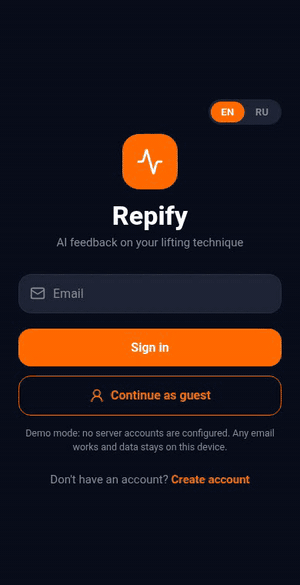
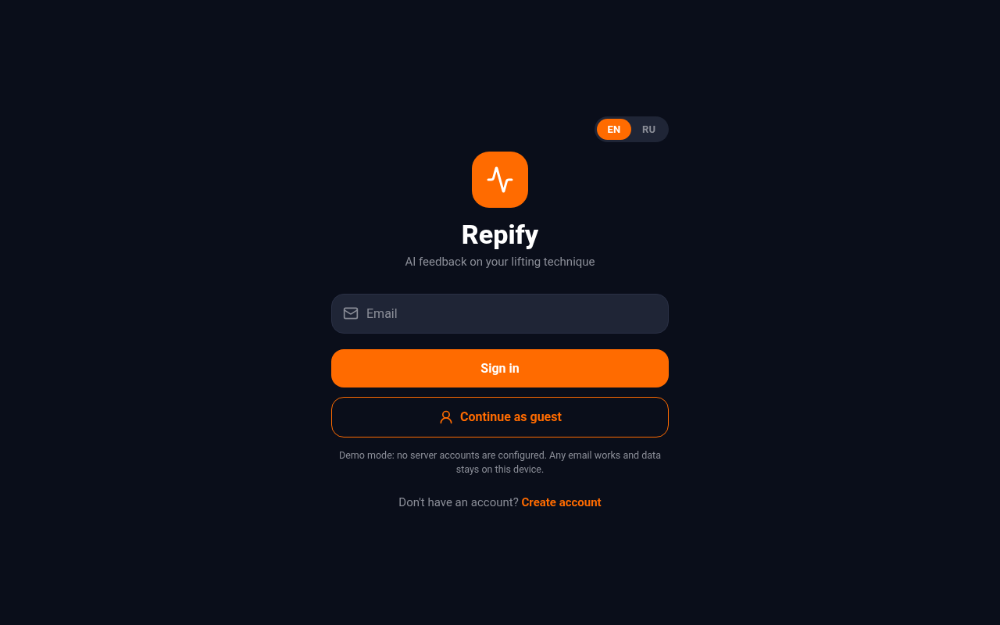
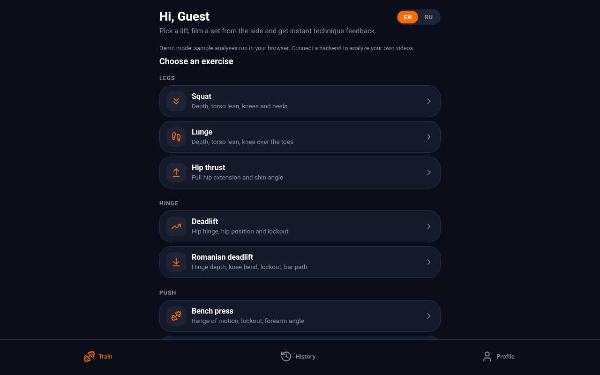
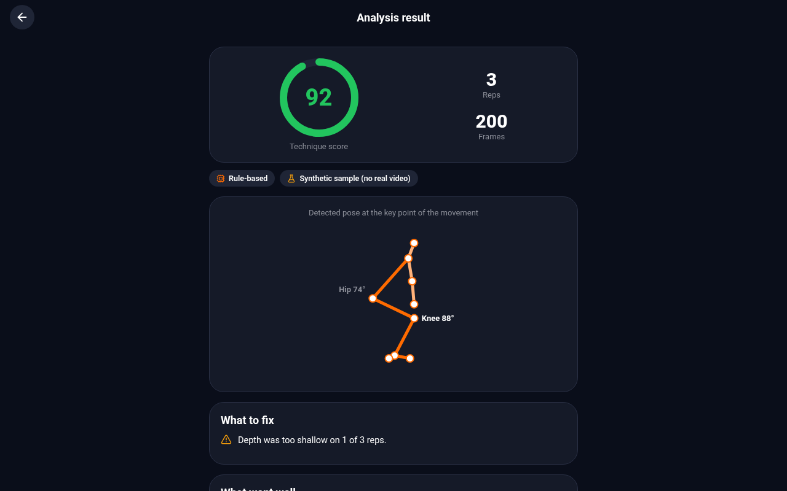
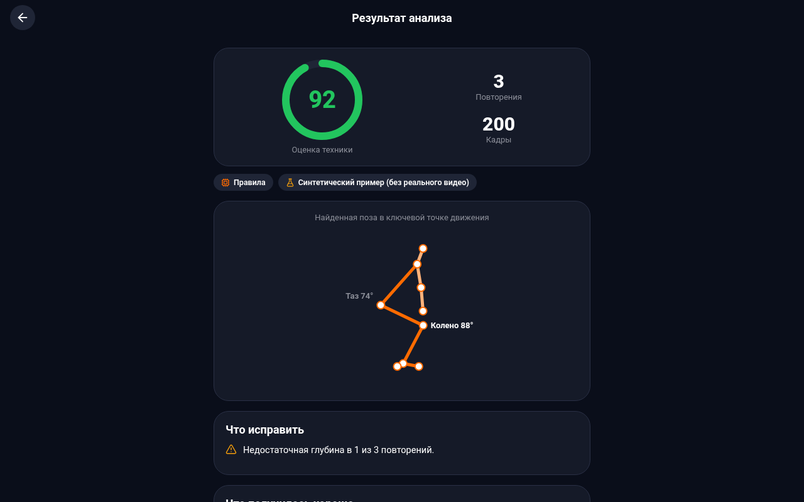
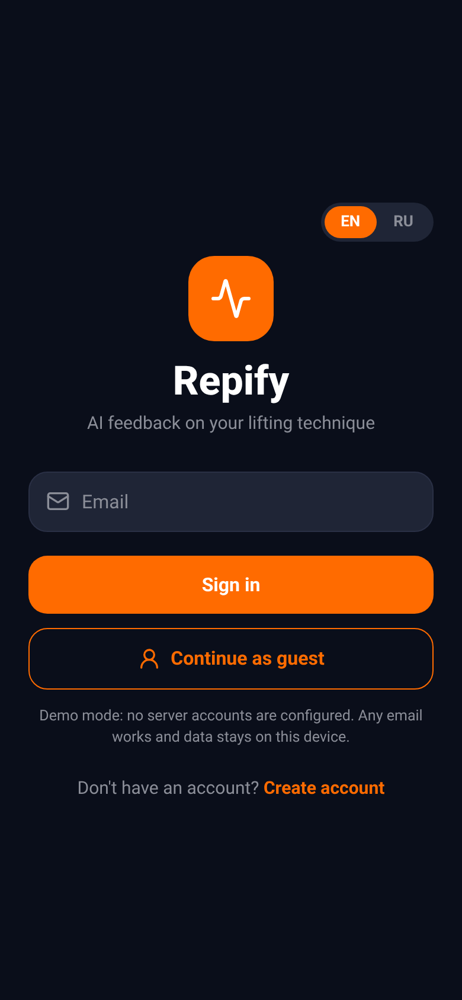
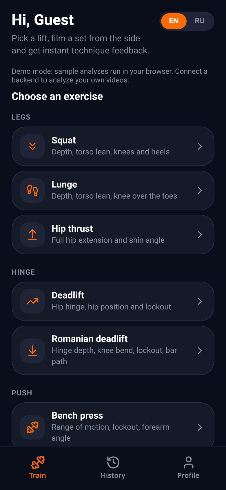
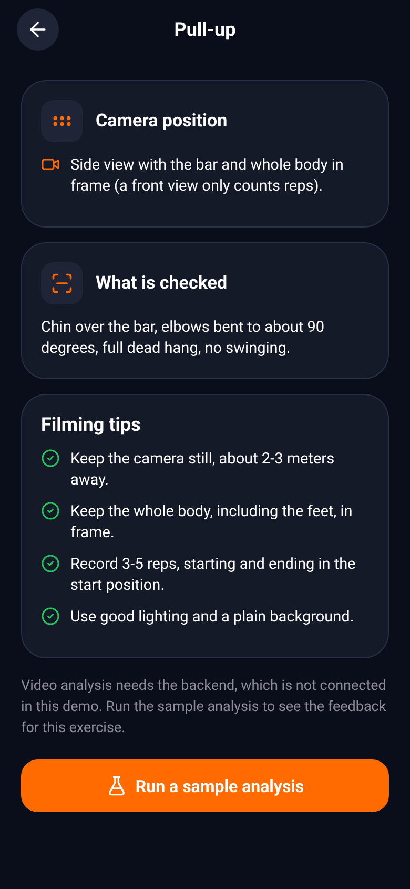
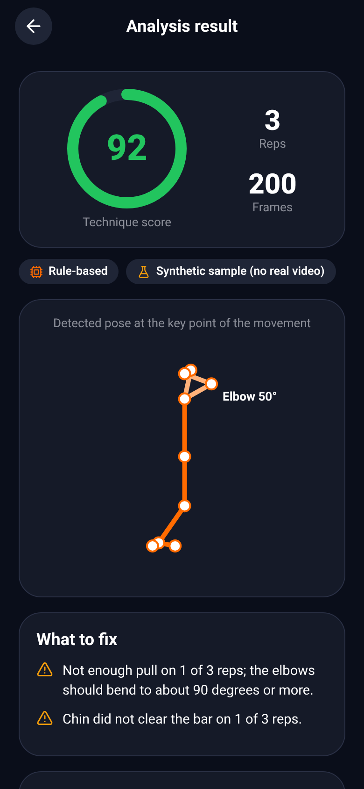
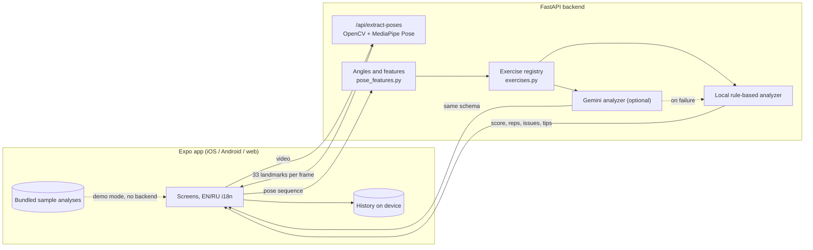

# Repify

[](https://github.com/ulykbek11/Repify/actions/workflows/ci.yml)
[](LICENSE)

**AI feedback on lifting technique from a single side-view video.** Film a set, and Repify finds your body landmarks, turns them into joint angles, counts the repetitions (or times the hold) and tells you what to fix: depth, lockout, torso lean, knee travel, body line, swing. 14 exercises, iOS / Android / web from one Expo codebase, English and Russian.

**Live demo: https://repify-mu.vercel.app** (demo mode: runs the analyzer on built-in sample sets in your browser, no account or server needed. Tap *Continue as guest*, pick a lift, tap *Run a sample analysis*.)

<p align="center">
  
</p>

## Features

- **14 exercises:** squat, deadlift, bench press, overhead press, push-up, pull-up, barbell row, lunge, Romanian deadlift, bicep curl, plank, hip thrust, dip, lat pulldown.
- **Real pose pipeline:** OpenCV frame sampling, MediaPipe Pose (33 landmarks), joint angles, a rep-counting state machine, per-rep scoring.
- **Explainable rules:** every threshold lives in one registry ([`exercises.py`](backend/app/services/exercises.py)); results list what to fix, what went well and one coaching tip.
- **Two engines, one schema:** deterministic local rules (default, no network) or Gemini on compact joint data, with automatic fallback to the local rules.
- **Demo mode without a backend:** sample analyses for all 14 exercises are bundled with the app, so the web build works on any static host.
- **EN / RU everywhere:** UI and feedback text; workout history stays on the device.
- **Extensible:** add an exercise with a spec, messages and a test. See [docs/ADDING_EXERCISES.md](docs/ADDING_EXERCISES.md).
- **Tested:** 191 backend tests (geometry, rep segmentation, scoring for all 14 exercises on synthetic landmark sequences, API, Gemini fallback), CI on Python 3.11 and 3.12.

## Screenshots

Desktop browser (demo mode):

| Sign in | Train | Squat result | Squat result (RU) |
|---|---|---|---|
|  |  |  |  |

Mobile width (390 px):

| Sign in | Train | Pull-up screen | Pull-up result |
|---|---|---|---|
|  |  |  |  |

The result screen draws the detected pose at the key point of the movement. Results in these screenshots come from the built-in synthetic samples (labelled as such in the UI), not from real footage.

## Architecture



- **Pose estimation:** MediaPipe Pose on the server, frames downscaled to 640x480.
- **Biomechanics:** angles at the knee (hip-knee-ankle), hip (shoulder-hip-knee) and elbow (shoulder-elbow-wrist), the body line (shoulder-hip-ankle), torso inclination, knee position relative to the toes, heel height, and a few landmark positions (wrist over elbow, nose above the bar, hip sway).
- **Personalisation:** the thigh to shin ratio is measured from the standing frames, so long-femur lifters are not penalised for extra forward lean.
- **Accounts:** Supabase Auth when configured, otherwise a local demo account (no server).

## How the rules work

Each exercise is a `Spec` in [`backend/app/services/exercises.py`](backend/app/services/exercises.py): which angle counts repetitions (`signal`), where a rep starts and ends (`rest`), how far it must go to count (`enter`), and a list of form `checks`.

1. The landmark sequence becomes per-frame angles, smoothed over time.
2. A small state machine finds repetitions: rest position, an excursion past the `enter` threshold, return to rest. Exercises that start low (overhead press, hip thrust) use the mirrored signal (`peak` mode). The plank (`hold` mode) is timed from frame timestamps.
3. Each check looks at one repetition (the extreme frame, the segment, or the frames around it) and returns a score penalty when violated, for example "elbow never got below 95 degrees".
4. Each repetition scores 100 minus its penalties, the set score is the average, and the response lists errors, strengths and a coaching tip from the messages in [`exercise_messages.py`](backend/app/services/exercise_messages.py) (EN and RU).

Thresholds are heuristics from common coaching cues. Change them in one place, and the tests tell you what moved.

## Supported exercises

Filming rule for all of them: **side view**, camera still, whole body in frame, 2-3 m away, start and finish every rep in the start position. Angles are in degrees; the pose is read in 2D, so a side view is what makes the joint angles trustworthy.

| Exercise (`id`) | Camera view | Rep signal | A rep counts when | Depth / ROM target | What is checked |
|---|---|---|---|---|---|
| Squat (`squat`) | Side, hip height | Knee angle (hip-knee-ankle) | from 160 or more, below 130, back above 160 | Knee 105 or less | Depth, torso lean over 60, knees far past the toes, heels lifting |
| Deadlift (`deadlift`) | Side, hip height | Hip angle (shoulder-hip-knee) | 160 or more, below 125, back | Lockout at 165 or more | Lockout, hips starting too low (knee under 85) |
| Bench press (`bench_press`) | Side of the bench, bar height | Elbow angle | 150 or more, below 110, back | Elbow 95 or less | Range, lockout 160 or more, forearm vertical at the bottom |
| Overhead press (`overhead_press`) | Side, chest height | Elbow angle (mirrored: low to high) | 115 or less, above 145, back | Lockout 165 or more | Lockout, leaning back over 15, bar over the shoulders |
| Push-up (`push_up`) | Side, floor level | Elbow angle | 150 or more, below 115, back | Elbow 100 or less | Depth, lockout, hips sagging, hips piked (body line under 160) |
| Pull-up (`pull_up`) | Side (a front view counts reps only) | Elbow angle | 150 or more, below 110, back | Elbow 90 or less, chin over the bar | Range, chin (nose above the wrist), full dead hang, body swing |
| Barbell row (`row`) | Side, hip height | Elbow angle | 150 or more, below 115, back | Elbow 100 or less | Range, torso too upright (under 30), torso heave (over 15 change) |
| Lunge (`lunge`) | Side, hip height | Knee angle of the near leg | 160 or more, below 125, back | Knee 105 or less | Depth, torso lean over 30, knee far past the toes |
| Romanian deadlift (`romanian_deadlift`) | Side, hip height | Hip angle | 160 or more, below 135, back | Hip 115 or less | Hinge depth, knees bending (under 130), lockout, bar drifting from the legs |
| Bicep curl (`bicep_curl`) | Side, chest height | Elbow angle | 150 or more, below 90, back | Elbow 65 or less | Top range, full extension 160 or more, elbows drifting forward, torso swing |
| Plank (`plank`) | Side, floor level | Body line (shoulder-hip-ankle) and time | Torso within 35 of horizontal | Hold 10 s or more, line 160 or more | Hips sagging, hips piked, shoulders over elbows, hold time; also a score per 5 s |
| Hip thrust (`hip_thrust`) | Side, hip height | Hip angle (mirrored: low to high) | 145 or less, above 160, back | Hip 170 or more | Full hip extension, vertical shins (knee 75-110) at the top |
| Dip (`dip`) | Side, chest height | Elbow angle | 150 or more, below 115, back | Elbow 100 or less | Depth, lockout, forward lean over 50 |
| Lat pulldown (`lat_pulldown`) | Side, shoulder height | Elbow angle | 150 or more, below 110, back | Elbow 100 or less | Range, full stretch at the top, lean over 35, torso rocking over 15 |

**All thresholds are heuristics.** They come from common coaching cues and were checked on synthetic landmark sequences (`backend/tests/test_exercises.py`), not on coach-labelled video, and they are defined in one place (`backend/app/services/exercises.py`) so they are easy to tune. Single-camera 2D analysis cannot judge elbow flare, knee valgus, spinal rounding or grip; those are not claimed. `GET /api/exercises` returns the same table as JSON.

## Quick start

You need Python 3.11 or 3.12 (MediaPipe 0.10.14 has no wheels for 3.13+) and Node 20+.

### Backend

```bash
cd backend
python3.11 -m venv .venv && source .venv/bin/activate
pip install -r requirements-dev.txt
cp .env.example .env            # optional: add GEMINI_API_KEY
uvicorn app.main:app --reload --port 8000
pytest -q                       # run the tests
```

Open http://localhost:8000/docs for the API; `GET /health` reports the active engine. Or with Docker: `docker build -t repify-api backend && docker run -p 8000:8000 repify-api`.

### App (mobile and web)

```bash
cd frontend
cp .env.example .env            # set EXPO_PUBLIC_API_URL (use your LAN IP on a phone)
npm install
npx expo start                  # press w for web, or scan the QR code with Expo Go
```

### Web only, no backend

```bash
cd frontend
npm install
EXPO_PUBLIC_API_URL= npm run build:web      # static site in frontend/dist
npx serve dist
```

## Demo mode

Every exercise page has **Run a sample analysis** (the Train tab also has one for squat). The backend generates a synthetic side-view set for that exercise (three reps with one deliberately weak rep, or a 14 second plank that sags at the end) and runs it through the same angle, rep-counting and scoring code as a real upload. The result is labelled as synthetic in the UI.

The sample results for all 14 exercises in English and Russian are also bundled with the app (`frontend/src/data/samples.json`, written by `backend/scripts/export_samples.py`, kept in sync by a test). When `EXPO_PUBLIC_API_URL` is empty the app runs in **demo mode**: samples come from the bundle, no server is needed, and uploading a video is hidden. This is how the Vercel preview works until a backend is attached.

## Configuration

| Variable | Where | Purpose |
|---|---|---|
| `GEMINI_API_KEY` | backend | Optional. Enables Gemini analysis. Without it the local analyzer is used. |
| `GEMINI_MODEL` | backend | Defaults to `gemini-2.5-flash`. |
| `CORS_ORIGINS` | backend | Comma-separated browser origins allowed to call the API. |
| `CORS_ORIGIN_REGEX` | backend | Optional regex for origins you cannot list, such as Vercel preview URLs. |
| `MAX_UPLOAD_MB` | backend | Upload limit for `/api/extract-poses` (default 60). |
| `EXPO_PUBLIC_API_URL` | app | Backend base URL. Empty means demo mode (bundled samples, no upload). |
| `EXPO_PUBLIC_SUPABASE_URL`, `EXPO_PUBLIC_SUPABASE_ANON_KEY` | app | Optional. Enables real accounts. |

Copy `backend/.env.example` and `frontend/.env.example`; the real `.env` files are git-ignored.

## Deploying

**Web app (Vercel).** Project root directory `frontend`, build command `npm run build:web`, output `dist` (`frontend/vercel.json` also rewrites every route to `index.html`). Without `EXPO_PUBLIC_API_URL` the build runs in demo mode (bundled sample analyses, no upload), so it works on its own.

**Backend (any container host).** `render.yaml` is a Render blueprint for `backend/Dockerfile`; Railway and Fly.io work with the same Dockerfile (give it about 1 GB of memory, MediaPipe plus OpenCV need it while a video is processed).

To attach the backend to the web app:

1. In Render choose **New -> Blueprint**, select this repository and branch, and apply it. Optionally set `GEMINI_API_KEY` for Gemini analysis (the rule-based analyzer is used without it).
2. Wait for the deploy, then open `https://<service>.onrender.com/health`. It should list the 14 exercises.
3. In Vercel open your Vercel project -> Settings -> Environment Variables and add `EXPO_PUBLIC_API_URL=https://<service>.onrender.com` (no trailing slash) for Production and Preview. It is read at build time, so redeploy afterwards.
4. If your web URL is not one of the Vercel URLs matched by the regex in `render.yaml`, add it to `CORS_ORIGINS` (exact origin, comma separated) or adjust `CORS_ORIGIN_REGEX` on the Render service.

**Mobile:** EAS Build (`eas build`) once a backend URL is available.

## Limitations

- Analysis assumes a single person filmed from the side with the whole body in frame. Knee valgus, elbow flare, spine rounding and grip cannot be judged from one 2D camera angle, and Repify does not claim to.
- Barbell lifts are judged from wrist and arm landmarks only; the bar itself is not detected. Plates, racks and benches can degrade pose quality.
- Lunges use the leg nearest to the camera; rear and front leg are not told apart.
- **The thresholds have not been validated against coach-labelled data.** The pipeline has been verified end to end on a still image of a person and on synthetic landmark sequences, not on a set of real lifting videos. Everything except squat and deadlift has only been exercised on synthetic sequences.
- The API has no authentication or rate limiting. Put it behind your own gateway before exposing it publicly.
- The hosted demo runs without a backend, so it cannot analyze your own video.
- Repify is a portfolio and learning project, not medical or professional coaching advice.

## Roadmap

- [ ] Validate and tune thresholds on real, coach-labelled clips for every exercise.
- [ ] Front and 45-degree views for the exercises where a side view is awkward.
- [ ] Bar detection (path and speed) for barbell lifts.
- [ ] Mobile builds through EAS and on-device pose estimation, so a backend is optional.
- [ ] Authentication and rate limiting for the API.
- [ ] More exercises (see [docs/ADDING_EXERCISES.md](docs/ADDING_EXERCISES.md)).

## Project history

The project went through several iterations: an ML-model experiment for technique classification, Python scripts for calibration and rep counting, a first web client, and then the React Native rewrite. The legacy code is preserved on the branch [`archive/pre-portfolio-cleanup`](../../tree/archive/pre-portfolio-cleanup).

## Repository layout

```
backend/    FastAPI service, analyzers, tests, Dockerfile, scripts/export_samples.py
frontend/   Expo app (screens, i18n, API client, auth, bundled sample analyses)
docs/       screenshots, demo GIF, ADDING_EXERCISES.md
render.yaml Render blueprint for the backend
.github/    GitHub Actions CI (backend pytest + ruff, frontend lint + web export)
```

## Contributing

Issues and pull requests are welcome, see [CONTRIBUTING.md](CONTRIBUTING.md).

## License

[MIT](LICENSE)
